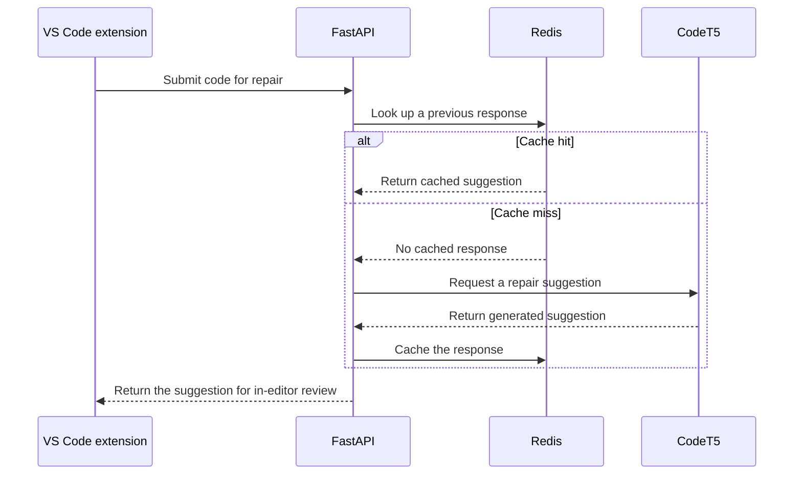
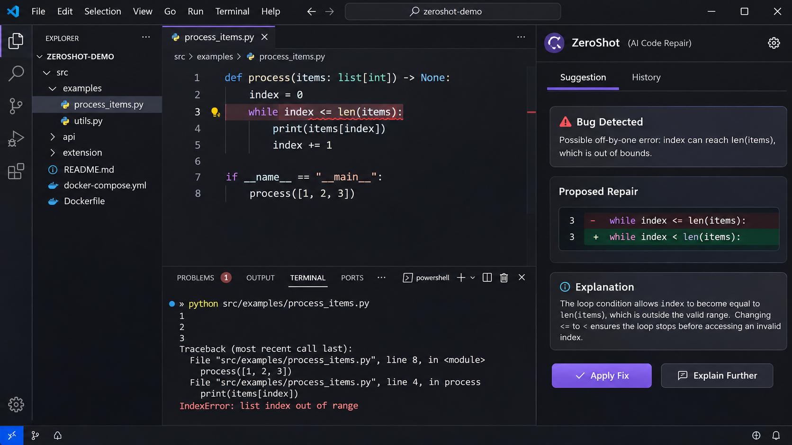
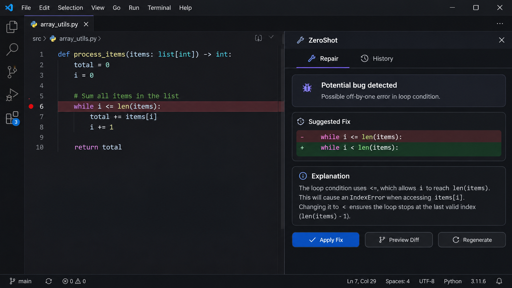

# ZeroShot | AI-Assisted Code Repair

ZeroShot brings AI-assisted code repair into VS Code so developers can review a proposed fix alongside the code it would change.

This public repository is a project showcase. The original source repository is private.

## What I built

- **VS Code extension.** Detects bugs and displays model-generated repair suggestions in the editor.
- **Inference API.** Serves the fine-tuned CodeT5 model through stateless, asynchronous FastAPI endpoints. Each repair request can be handled independently of an editor session.
- **Response cache.** Stores repair responses in Redis. When a repeat request matches a cached result, the service can return that result without running inference again.
- **Container packaging.** Packages the inference service in Docker for containerized deployment.

## Repair request flow

The diagram shows the high-level interaction between the editor, the API, the cache, and the model after code is submitted for repair.

## VS Code repair examples

Both views illustrate an off-by-one error. The loop can reach an index equal to the length of the list, which causes an `IndexError`. The suggested change replaces `<=` with `<` so the loop stops before that access.

*Bug repair panel showing the terminal error alongside the proposed change.*

*Loop repair view showing the one-line change in a function that sums a list.*
